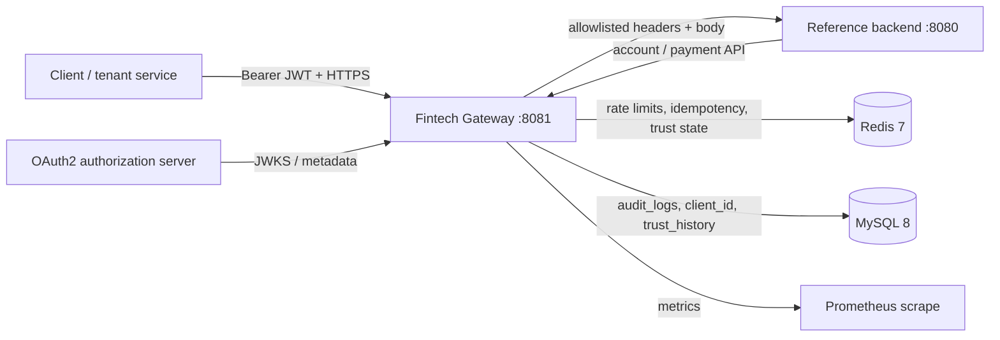

# Fintech API Security Gateway

An adaptive API gateway for small fintech workloads. It sits in front of a
payment/account backend and makes every request pass through OAuth2 client
authentication, identity-aware rate limiting, WAF inspection, risk scoring,
tenant-scoped idempotency and a durable audit trail.

> **Status: validation build, not generally available.** The business verdict is
> **VALIDATE FIRST** — see [BUSINESS_VALIDATION.md](BUSINESS_VALIDATION.md).
> The gateway is a credible design-partner pilot. It is not a drop-in
> Stripe/Block/NPCI replacement, and the evidence export is runtime evidence,
> not a certification. See [Production readiness](#production-readiness).

---

## Why this exists

Commodity gateways (Kong, NGINX, Spring Cloud Gateway) proxy traffic and can
enforce static rate limits. They do not understand a fintech tenant, a payment
retry, or an RBI/PCI evidence request. This project combines those controls in
one Spring Boot service and turns the runtime data into bounded, operator-only
evidence:

- Who called which endpoint, from which IP, tenant and OAuth2 client?
- What did the gateway decide (ALLOW / THROTTLE / BLOCK), and why?
- Was a payment retried, and was the duplicate suppressed?
- When did a trust tier change, and what caused it?
- Can an operator export the audit rows for a control-testing window without
  dumping the whole database into a spreadsheet?

The audit tables and structured logs remain the source of truth. The
`/compliance/evidence` endpoints summarize them and export bounded CSV. That is
evidence for control testing; it is explicitly not an attestation that a
customer is PCI-DSS, RBI or NPCI compliant.

---

## Architecture



The gateway is stateless apart from Redis and MySQL, so multiple instances can
share the same limits and idempotency state. A TLS-terminating proxy or load
balancer is expected in front of it; the container publishes on loopback by
default.

### Request lifecycle

Filters run in this order (lower order value first):

| Order | Filter | Responsibility |
|---:|---|---|
| `HIGHEST_PRECEDENCE` | `RequestIdFilter` | Validate or generate `X-Request-Id`, populate MDC |
| 1 | `SecurityHeadersFilter` | HSTS, CSP, frame/deny, no-sniff, cache policy |
| 2 | `InternalOpsAuthFilter` | Authenticate `/feedback/**` and `/compliance/**` with `X-Internal-Ops-Key` |
| 3 | `ClientAuthFilter` | Validate the OAuth2 Bearer JWT and bind tenant/client/scopes |
| 4 | `RequestLoggingFilter` | Admission pipeline for all non-internal paths |
| — | `GatewayController` | Forward the buffered request and return the upstream response |

`RequestLoggingFilter` performs, in order:

1. Use the authenticated tenant from the signed token claim. When client
   authentication is explicitly disabled (dev only), fall back to the
   `X-Tenant-Id` header and default tenant.
2. Resolve the caller IP. `X-Forwarded-For` is ignored unless
   `TRUST_PROXY=true`; spoofed or malformed values fall back to the socket IP.
3. Resolve blacklist, trust tier, tenant+client quota and tenant+IP abuse
   ceiling in one atomic Redis script. Blacklisted callers get HTTP 403;
   exhausted callers get HTTP 429 with `Retry-After` and `X-RateLimit-*`
   headers.
4. Reject methods outside the proxy allowlist with HTTP 405 before any body is
   read; the request is audited as `BLOCK` / `METHOD_NOT_ALLOWED`.
5. Buffer the body up to `MAX_BODY_BYTES`, then normalize and inspect it for
   SQL injection, XSS, path traversal and command injection.
6. Score risk (endpoint sensitivity, payload size, business-hour window, trust
   tier) and decide ALLOW / THROTTLE / BLOCK.
7. For unsafe methods on `/api/payments`, require an `Idempotency-Key` and claim
   it atomically. Replays return the stored response; concurrent duplicates get
   HTTP 409.
8. Proxy to the backend, release or complete the idempotency claim, record good
   behaviour asynchronously, enqueue the audit row (including `client_id`) and
   emit metrics. No INSERT runs on a Tomcat thread.

Internal paths (`/health`, `/actuator`, `/feedback`, `/compliance`,
`/swagger-ui`, `/v3/api-docs`, `/error`) bypass the admission pipeline. Browser
CORS preflight bypasses both auth filters only when
`gateway.cors.allowed-origins` contains at least one non-blank origin.

---

## Quick start with Docker Compose

Requirements: Docker Engine with Compose v2, and about 4 GB of free RAM.

```bash
cp .env.example .env
# Replace MYSQL_ROOT_PASSWORD, MYSQL_PASSWORD and INTERNAL_OPS_API_KEY.
# Use: openssl rand -hex 32

docker compose up --build -d
docker compose ps
```

The first build compiles each Maven module inside its image. When all
containers report healthy:

```bash
curl http://localhost:8081/health
curl http://localhost:8081/actuator/health/readiness

curl "http://localhost:8081/api/account/balance?accountId=ACC123"

curl -X POST http://localhost:8081/api/payments/transfer \
  -H 'Content-Type: application/json' \
  -H 'Idempotency-Key: demo-payment-1' \
  -d '{"fromAccountId":"ACC123","toAccountId":"ACC456","amount":500,"currency":"INR","idempotencyKey":"demo-payment-1"}'
```

Repeat the payment call with the same key: the response is replayed from Redis
with `Idempotency-Replayed: true`, and the backend is not called again.

The Compose default is `SPRING_PROFILES_ACTIVE=dev`, which disables client
authentication so the demo works without an IdP. That is a local/demo mode
only. The base configuration and the `prod` profile both require client
authentication; the gateway refuses to start without `OAUTH2_ISSUER_URI` or
`OAUTH2_JWK_SET_URI`.

To run the stack with real token validation:

```bash
# in .env
SPRING_PROFILES_ACTIVE=prod
GATEWAY_AUTH_ENABLED=true
OAUTH2_JWK_SET_URI=https://auth.example.com/.well-known/jwks.json
OAUTH2_ISSUER_URI=https://auth.example.com
OAUTH2_AUDIENCE=fintech-gateway
OAUTH2_REQUIRED_SCOPES=gateway.api
```

Then send `Authorization: Bearer <token>` on every API request. The token must
carry the configured tenant claim (default `tenant_id`) and the required scope.

Swagger UI is available at <http://localhost:8081/swagger-ui.html> only while
`SPRING_PROFILES_ACTIVE=dev`. Production disables it.

To stop the stack:

```bash
docker compose down          # keep data
docker compose down -v       # also delete MySQL/Redis/log volumes
```

The Flyway baseline expects a fresh schema. If you are reusing a pre-Flyway
development volume, reset it once with `docker compose down -v`.

### Demo UI

The static page in `fintech-frontend/fintech-frontend` exercises every feature:

```bash
cd fintech-frontend/fintech-frontend
python3 -m http.server 3000
```

Open <http://localhost:3000>. The dev profile allows that origin. Enter the
operator key in the Feedback section; it is sent as `X-Internal-Ops-Key`.

### Run locally without Docker

Start MySQL 8 on port 3307 and Redis 7 on port 6379, then:

```bash
export MYSQL_PASSWORD=your-local-password
export INTERNAL_OPS_API_KEY=dev-ops-key-change-me

# terminal 1 — reference backend
mvn -pl fintech-backend/fintech-backend spring-boot:run

# terminal 2 — gateway
mvn -pl fintech-gateway/fintech-gateway spring-boot:run \
  -Dspring-boot.run.profiles=dev
```

The base profile has no default MySQL password on purpose; startup fails if
`MYSQL_PASSWORD` is unset. The `dev` profile supplies a local default password
and the demo operator key. Never use either in production.

---

## Client authentication

Client-credentials JWTs are validated locally; the gateway is a resource
server, not an authorization server. It uses Spring Security's JWT decoder
without enabling the servlet security filter chain, so there is still one
explicit admission pipeline.

| Check | Behavior |
|---|---|
| Token source | `OAUTH2_JWK_SET_URI` preferred; `OAUTH2_ISSUER_URI` enables metadata discovery and issuer validation |
| Signature, expiry, not-before | Validated by the decoder with configurable `OAUTH2_CLOCK_SKEW` |
| Issuer | Validated when `OAUTH2_ISSUER_URI` is set |
| Audience | Validated when `OAUTH2_AUDIENCE` is non-empty (default `fintech-gateway`) |
| Tenant | `tenant_id` claim must exist, match `TENANT_PATTERN`, and match any `X-Tenant-Id` header if one is sent |
| Client id | `client_id` claim, falling back to `sub`; stored in the audit row and CSV |
| Scope | `OAUTH2_REQUIRED_SCOPES` (prod defaults to `gateway.api`) must all be present in `scope` |
| Missing configuration | Startup fails when auth is enabled and neither issuer nor JWK set is configured |
| IdP outage | JWKS/network failures return 503 `auth_dependency_unavailable`; they never fall through to the upstream |
| Dev disable | Only the `dev` profile defaults `GATEWAY_AUTH_ENABLED=false`; the `prod` profile refuses to start with auth disabled |

Failure responses include a `WWW-Authenticate: Bearer` challenge where one is
defined by RFC 6750. All failures are audited as `BLOCK` with a specific
`attack_type` and counted in `gateway.auth.failures{reason}`.

This is authentication and coarse scope authorization, not full multi-tenant
policy. Per-client quotas, RBAC, admin roles and key rotation through an IdP are
still operator responsibilities.

---

## Security controls

| Control | Behavior |
|---|---|
| Caller authentication | OAuth2 client-credentials JWT; tenant derived from a signed claim, not a header |
| Tenant binding | A mismatched `X-Tenant-Id` is rejected with 403 when auth is enabled |
| Fail-closed admission | Redis/trust-store failures return HTTP 503, never "allow because we cannot check" |
| Auth dependency | JWKS/network failure returns 503, not 401/403 and not an unauthenticated pass-through |
| WAF normalization | Up to 3 decoding passes, HTML entities, Unicode compatibility forms, control-character stripping |
| Method allowlist | `GET/HEAD/POST/PUT/PATCH/DELETE/OPTIONS` only; `TRACE`, `CONNECT` and arbitrary tokens get 405, are audited as `BLOCK`, and never reach the body reader |
| Body limit | `MAX_BODY_BYTES` (default 1 MiB); oversized requests get 413 before WAF work |
| Request encoding | Compressed request bodies get 415; the WAF only inspects plaintext, and silently forwarding compressed bytes would bypass it |
| Upstream response limit | `MAX_UPSTREAM_RESPONSE_BYTES` (default 10 MiB); oversized responses get 502 without unbounded buffering |
| Idempotency | Tenant-scoped `SET NX EX` claim with a unique owner token; Lua compare-and-set/delete refuses stale owners; required on `/api/payments` |
| Rate limiting | Tenant+client quota (GCRA by default, exact sorted-set fallback) plus tenant+IP abuse ceiling; tier limits 50/30/10/0; fail-closed |
| Trust tiers | HIGH/MEDIUM/LOW/BLACKLISTED with Caffeine 30s cache; blacklist never cached; 4 blocks in 24h blacklists |
| Audit sampling | Only clean 2xx ALLOW traffic is eligible; blocks, auth failures, WAF detections, payment paths and idempotent requests are always persisted; the effective rate is disclosed on every compliance response |
| Audit persistence | Two bounded queues (critical/sampled) and one background batch writer; a full queue drops and counts instead of blocking the request |
| Operator auth | SHA-256 + `MessageDigest.isEqual`; unset key rejects every `/feedback/**` and `/compliance/**` call; 10 failures per 15 min locks the IP out |
| Compliance export | Operator-only, row- and window-bounded, `Cache-Control: no-store`, CSV fields quoted and formula-neutralized |
| Proxy trust | `X-Forwarded-For` ignored unless `TRUST_PROXY=true`; IP syntax validated |
| mTLS | Opt-in via Spring SSL bundles (`spring.ssl.bundle.*`); key material stays outside gateway properties |
| Response headers | Upstream headers are filtered to a safe allowlist; internal headers are not leaked |
| Browser hardening | CSP, HSTS (configurable), frame deny, no-sniff, permissions policy, no-store on operator endpoints |

### Compliance evidence, precisely

`GET /compliance/evidence/summary` returns a bounded summary (decision counts,
WAF detections, rate-limit rejections, idempotency replays, authentication
failures, distinct tenants/clients, trust transitions, coverage metadata).

`GET /compliance/evidence/audit.csv` returns a bounded CSV export with
`id, timestamp, tenant_id, client_id, ip, method, uri, decision, risk_score,
attack_type, status_code, latency_ms, request_id, sample_rate, dataset_sampled`.

Both require `X-Internal-Ops-Key`. The window defaults to 24 hours, cannot
exceed 90 days, and rows default to 1,000 with a 10,000 cap. Exports larger than
the cap are marked `X-Evidence-Truncated: true`; the operator must narrow the
window. Every export is itself audited (`COMPLIANCE_EXPORT`) and counted in
`gateway.compliance.export{type}`.

When `AUDIT_SAMPLE_RATE < 1.0`, both endpoints also return `"sampled": true`,
`"sampleRate": <n>`, `X-Evidence-Sampled` and `X-Evidence-Sample-Rate`. The CSV
repeats the rate on every row, so an exported file cannot be mistaken for a
complete trail after it leaves the gateway. See
[ADR-001](docs/adr/ADR-001-audit-sampling.md) for the never-sampled list.

`wafDetections` is a positive allowlist of the four WAF signature families the
gateway emits (`SQL_INJECTION`, `XSS`, `PATH_TRAVERSAL`, `COMMAND_INJECTION`).
Gateway-operational events (rate limits, replays, method rejections, auth
failures, exports) are never counted as WAF detections, and adding a new
operational event cannot silently inflate the number. Legacy audit rows written
before the `client_id` migration are counted in
`coverage.legacyRowsWithoutClientId`.

**What this is not:** a PCI-DSS/RBI/NPCI control mapping, a signed report, a
retention guarantee, or an audit opinion. Those require a documented control
matrix, evidence retention, review/sign-off workflow and external audit. The
export is the raw material for that process, not a replacement for it.

---

## Observability

| Endpoint | Meaning |
|---|---|
| `GET /health` | Process liveness only; no dependency calls |
| `GET /actuator/health/liveness` | Kubernetes liveness probe |
| `GET /actuator/health/readiness` | Readiness; includes MySQL and Redis |
| `GET /actuator/health` | All contributors |
| `GET /actuator/prometheus` | Prometheus exposition |

Metrics are intentionally low-cardinality (tenant and IP are not tags):

- `gateway.requests{decision,status}`
- `gateway.request.duration{decision}`
- `gateway.waf.blocked{threat}`
- `gateway.rate.limited`
- `gateway.idempotency.replay`
- `gateway.idempotency.store.failure`
- `gateway.idempotency.release.failure`
- `gateway.upstream.errors`
- `gateway.security.dependency.failure`
- `gateway.auth.failures{reason}`
- `gateway.compliance.export{type}`
- `gateway.audit.sampled_out`
- `gateway.audit.persisted{dataset}`
- `gateway.audit.dropped{dataset,reason}`
- `gateway.audit.write.failures`
- `gateway.audit.queue.depth{dataset}`

The audit trail is written to three places: the `AUDIT` logger (stdout and
`audit.log`), the `audit_logs` table, and `trust_history` for tier changes.
Attacker-controlled fields are sanitized and truncated before logging. Once
client authentication is enabled, each audit row records the authenticated
`client_id` (or `internal-ops` for evidence exports). Durable rows are written
by a background batch writer; at `AUDIT_SAMPLE_RATE=1.0` every event is queued
on the critical dataset, exactly as before sampling existed.

Log retention defaults: audit 90 days / 20 GB cap, application 30 days / 5 GB
cap. In containers these live in the `gateway_logs` volume. Ship them to your
SIEM and back up MySQL; a local volume is not a compliance archive.

See [docs/OPERATIONS.md](docs/OPERATIONS.md) for the runbook.

---

## Configuration

Every knob is environment-overridable. The full table is in
[docs/CONFIGURATION.md](docs/CONFIGURATION.md). The most important variables:

| Variable | Default | Purpose |
|---|---|---|
| `SERVER_PORT` | `8081` | Gateway HTTP port |
| `MYSQL_HOST` / `MYSQL_PORT` / `MYSQL_DB` | `localhost` / `3307` / `FintechGateway` | Audit database |
| `MYSQL_USER` / `MYSQL_PASSWORD` | `fintech` / none | Database credentials (password required) |
| `REDIS_HOST` / `REDIS_PORT` / `REDIS_PASSWORD` | `localhost` / `6379` / empty | Admission state |
| `BACKEND_URL` | `http://localhost:8080` | Upstream base URL |
| `GATEWAY_AUTH_ENABLED` | `true` | Disable only in the `dev` profile or isolated tests |
| `OAUTH2_JWK_SET_URI` | empty | Direct JWKS endpoint; preferred in production |
| `OAUTH2_ISSUER_URI` | empty | Issuer and metadata discovery source |
| `OAUTH2_AUDIENCE` | `fintech-gateway` | Required `aud` claim |
| `OAUTH2_REQUIRED_SCOPES` | empty (`gateway.api` in prod) | Required scopes |
| `INTERNAL_OPS_API_KEY` | empty | `/feedback/**` and `/compliance/**` key; empty rejects all |
| `TRUST_PROXY` | `false` | Trust `X-Forwarded-For` |
| `MAX_BODY_BYTES` | `1048576` | Request body cap |
| `MAX_UPSTREAM_RESPONSE_BYTES` | `10485760` | Upstream response cap |
| `RATE_LIMIT_ENABLED` | `true` | Disable only for isolated tests |
| `RATE_LIMIT_ALGORITHM` | `gcra` | `gcra` (O(1) state) or `sorted-set` (exact reference) |
| `RATE_ABUSE_LIMIT_PER_IP` | `6000` | Coarse per-tenant, per-IP ceiling; raise for capacity tests |
| `AUDIT_SAMPLE_RATE` | `1.0` | `1.0` persists every audit event; below `1.0` samples only clean ALLOW traffic (`prod` floor `0.01`) |
| `IDEMPOTENCY_TTL` | `24h` | Replay window |
| `COMPLIANCE_DEFAULT_WINDOW` / `COMPLIANCE_MAX_WINDOW` | `24h` / `90d` | Evidence window bounds |
| `COMPLIANCE_DEFAULT_ROWS` / `COMPLIANCE_MAX_ROWS` | `1000` / `10000` | CSV row bounds |
| `CORS_ALLOWED_ORIGINS` | localhost dev origins | Browser origin allowlist |

---

## Testing

```bash
mvn clean verify
```

The suite is pure JUnit 5 + Mockito and does not need Docker or a Spring
context by default. It currently covers **346 tests** (345 gateway + 1 backend).
Eight of the gateway tests are an opt-in real-Redis contract suite and are
reported as skipped unless enabled:

```bash
docker run --rm -d --name gw-redis-it -p 6390:6379 redis:7.4-alpine
GATEWAY_REDIS_IT=true GATEWAY_IT_REDIS_PORT=6390 \
  mvn -pl fintech-gateway/fintech-gateway test -Dtest=RateLimitScriptsIntegrationTest
```

The unit suite covers WAF signatures and normalization, risk decisions, the
admission script contract as Java sees it, cost accounting for THROTTLE
penalties, atomic idempotency (owner-tokened claims, byte-identical replay of
compressed responses, storage-failure delivery), compressed-body rejection,
trust tiers, wrappers, filters, proxy status/header/response-limit handling,
OAuth2 token validation and failure mapping, tenant binding, audit sampling and
batching, audit sanitization, compliance summary/CSV bounds and formula
neutralization, feedback, controller method allowlist and request-context
helpers. The real-Redis suite covers what mocks cannot: exact burst size,
cost borrowing, refill timing, sub-millisecond emission intervals,
blacklist/trust interaction and the tenant+IP abuse ceiling.

MySQL and a real HTTP upstream still have **no JUnit integration suite**.
Testcontainers was removed because Docker was unavailable in the development
environment; the limiter's real-Redis contract test above is the first slice of
that gap being closed. CI starts the Compose stack and runs end-to-end smoke
checks (health, balance, payment replay, WAF, method allowlist, body encoding,
operator auth, compliance export), but that is a deployment smoke test, not a
full integration suite. This remains a gap before calling the system
production-verified. The JWT tests use a real loopback JWK server and real RS256
tokens, so signature, issuer, audience and claim handling are exercised without
a mock decoder.

Load-test methodology, hardware disclosure and real measurements live in
[`load-tests/CAPACITY.md`](load-tests/CAPACITY.md). The older `load-tests/RESULTS.md`
numbers came from a closed-loop script and are kept only as history, not as a
capacity claim.

---

## Production readiness

### Implemented and tested

- OAuth2 client-credentials authentication with local JWT validation, tenant
  binding, scope checks and fail-closed IdP outage handling.
- Deterministic admission pipeline with fail-closed dependency handling.
- Atomic, tenant-scoped idempotency.
- Tenant+client GCRA quota and tenant+IP abuse ceiling, with an exact
  sorted-set fallback for auditors who want reference semantics.
- WAF normalization and bounded request/response buffering.
- Durable audit schema, `client_id` attribution and Flyway migrations.
- Deterministic audit sampling with a never-sample security list, bounded
  dual-queue buffering and a batch writer outside the request path.
- Bounded compliance evidence summary and CSV export for operators, with
  sampling disclosed on every response and row.
- Operator authentication with constant-time comparison and Redis lockout.
- Health/readiness separation, graceful shutdown, bounded audit buffer.
- Non-root, read-only container images; loopback-only published ports.
- CI for build, tests, Compose validation and a live stack smoke test.

### Not done — do not claim GA without these

1. **Full integration suite.** MySQL/Flyway upgrade and restore path, upstream
   error/timeout matrix, concurrent idempotency race, live IdP/JWKS rotation and
   soak tests under Testcontainers. The limiter Lua has an opt-in real-Redis
   contract test; the rest still relies on the Compose smoke test.
2. **High availability.** Kubernetes/Helm manifests, PodDisruptionBudgets,
   Redis Sentinel/Cluster, MySQL replication, tested restore procedure.
3. **Secrets management.** Vault/cloud secret manager integration and key
   rotation without restart; no secrets in `.env` on shared hosts.
4. **Operational controls.** Admin UI/RBAC for trust resets, per-client and
   per-tenant policy management, billing/metering, usage quotas.
5. **Compliance productization.** A documented PCI-DSS/RBI/NPCI control matrix,
   evidence retention and sign-off workflow, scheduled report generation.
6. **Security validation.** External penetration test, dependency/container
   scanning in CI, WAF false-positive tuning against real traffic.
7. **Support and SLA.** Support tiers, incident response commitments, and
   commercial terms. The source is proprietary (see [LICENSE](LICENSE)); public
   visibility does not grant usage rights.

The honest commercial position: this is a strong technical foundation for a
design-partner pilot, not a product that can be sold as a drop-in replacement
for Stripe or NPCI infrastructure today. Validate demand and the compliance
evidence workflow with 3–5 design partners before expanding scope.

---

## Repository layout

```
fintech-gateway/fintech-gateway/   Spring Boot gateway (the product)
fintech-backend/fintech-backend/   Reference account/payment backend
fintech-frontend/fintech-frontend/ Static demo UI
load-tests/                        k6 scripts
docs/                              Operations and configuration reference
docker-compose.yml                 Gateway + backend + MySQL + Redis
.github/workflows/ci.yml           Build, test, Compose validation, live stack smoke test
BUSINESS_VALIDATION.md             Market, pricing and go/no-go analysis
LICENSE                            Proprietary license; no usage rights without an agreement
```

## Further reading

- [docs/CONFIGURATION.md](docs/CONFIGURATION.md) — every environment variable.
- [docs/OPERATIONS.md](docs/OPERATIONS.md) — health semantics, failure matrix,
  auth incident procedures, compliance export, backup and capacity notes.
- [BUSINESS_VALIDATION.md](BUSINESS_VALIDATION.md) — why the verdict is
  VALIDATE FIRST.

## License

Proprietary and confidential. All rights reserved. Public visibility does not
grant any right to use, copy, modify or deploy the code. See [LICENSE](LICENSE).

